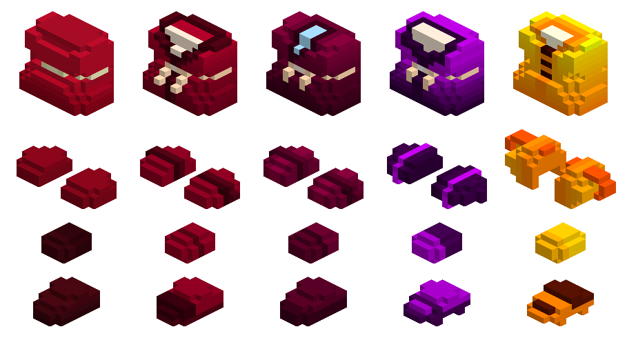

# Cube World Satin Armor Mod

The game files carry an unused satin armour set. It was likely to be an
alternative or upgrade to the mages silk armor. This mod replaces the current
silk armor pieces with the satin armor pieces.

They are mostly a recolour, though the voxel models differ slightly, but keep a
similar style. Only the models are swapped, their names stay the same and are
also crafted in the same way. In multiplayer, other players without this mod
will see the original silk models.

Unlike the vanilla armour sets, which have five variants for each piece and
rarity level, satin provides only one model per piece and rarity level. All
variants for a piece and rarity level will look the same with this mod.

*Rows: chest, shoulders, gloves, boots. Columns by rarity: common, uncommon, rare, epic, legendary*

This mod is for the **alpha** build of Cube World.

## Installation

* requires [coremaze Cube-World-Mod-Launcher](https://github.com/coremaze/Cube-World-Mod-Launcher/releases/tag/v1.5)
* unpack Mod Launcher in the game directory
* put `SatinArmor.dll` into `Mods`
* start the game via `CubeModLauncher.exe`

## Compilation

Requires a compiler that targets 32-bit Windows. Run `make` in this directory
and specify the compiler as `CXX` variable if necessary (e.g.
`make CXX=i686-w64-mingw32-g++`).
